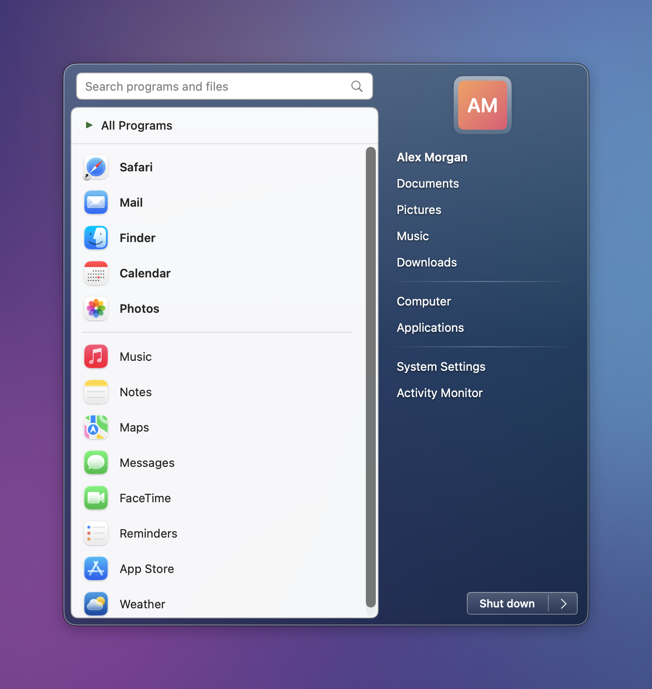

# Mac2Seven

A menu bar app launcher with a classic two-column Start-menu layout, plus an optional Windows-style taskbar.

<p align="center">
  
</p>

**[Download Mac2Seven](https://github.com/saoneill01-a11y/Mac2Seven/releases/latest/download/Mac2Seven.dmg)** · macOS 14 or later · signed and notarized

## Use
- **Open:** click the menu bar icon, or press **⌥Space** anywhere.
- **Pinned apps:** right-click any app → *Pin to Start Menu*, or drag an app (from the menu or Finder) onto the list. Drag pinned apps up or down to reorder them; a blue line shows where they'll land.
- **Frequently used:** fills in automatically from the apps you launch.
- **All Programs:** make folders (and subfolders), then drag apps anywhere into a folder (its title or, when open, anywhere in its contents) or use right-click → *Move to Folder*. Drag apps up or down to reorder them, at the top level or inside a folder. Drag a folder onto another folder's title to put it above or below; drop it inside an open folder to make it a subfolder, or on empty space to move it back to the top level. Hovering a closed folder while dragging opens it. Right-click a folder to rename or delete it.
- **Search:** just start typing. Use ↑/↓ to pick a result and Return to open it. Esc clears the search, then closes the menu.
- **Right-click the menu bar icon** for Settings, Show Data Folder, and Quit. New apps appear automatically: the menu rescans your app folders every time it opens.
- **Settings** (right-click → Settings…, or ⌘, while the menu is open):
  - *General:* Launch at Login, the shortcut that opens the menu, and what the power button does.
  - *Taskbar:* turn the taskbar on and set it up (see [Taskbar](#taskbar) below).
  - *Appearance:* Light / Dark / Match System, the Glass or Flat theme, and the accent color.
  - *Places:* edit the right-hand column (add folders or apps, separators, rename, reorder), and switch Documents/Pictures/Desktop to your OneDrive folders in one click.
  - *Organize:* suggests folders by developer (Microsoft, Autodesk…) and creates them in one click; after that, new apps from those developers file themselves. Also controls auto-hiding of helpers and lists hidden apps.
  - *History:* how many frequently used apps to show, and Clear History.
  - *Backup:* export your layout (pins, folders, hidden apps, places, appearance) to a file — e.g. in OneDrive — and import it later or on another Mac. Importing saves your current layout to the data folder first.
- **About Mac2Seven** and **Check for Updates…** are in the menu bar icon's right-click menu.
- **Automatic updates** (via [Sparkle](https://sparkle-project.org)): Mac2Seven checks once a day and asks before installing. Turn it off in Settings → General.
- **More than one display?** The menu opens on the screen your mouse is on.
- **Data safety:** if a saved file ever can't be read, Mac2Seven renames it (`*.unreadable-<date>.json`) instead of overwriting it, and tells you.
- **Hide apps:** right-click → *Hide*. Helpers, installers and uninstallers (names with Helper, Service, Agent, Uninstaller…, or starting with Remove) are hidden automatically unless you've pinned or filed them. Hidden apps live in a *Hidden* folder at the bottom of All Programs and still show up in search.
- **New apps** get a *New* badge for a week (or until you open them), and All Programs shows the badge when something new is waiting.

Your pins, folders and history are stored in `~/Library/Application Support/Mac2Seven/library.json`; settings are in `settings.json` in the same folder.

## Taskbar
Turn it on in **Settings → Taskbar**. It runs along the bottom of the screen (on every display, or only the main one) and works like the Windows 11 taskbar:

- **Start button:** the Mac2Seven icon opens the Start menu just above it. Click it again to close the menu.
- **App buttons:** pinned apps plus everything that's running. A dot marks running apps and a blue line marks the one in front. Click an app that isn't running to open it; click one with a single window to bring that window forward, or minimize it if it's already in front; click one with several windows to pick from their previews.
- **Previews:** hover over a button to see its windows, click one to switch to it, or close it with its ×. Minimized windows keep the last picture taken of them.
- **Right-click a button** to open a new window, pin or unpin it, minimize or restore, close one or all of its windows, quit the app, or show it in Finder. Right-click the empty bar for Taskbar Settings.
- **Button styles:** *Combine (icons only)*, *Combine (with app names)* — one button per app with its name and a window count — or *Never combine (window titles)*, one labeled button per window.
- **Layout:** 1 to 3 rows, centered or left-aligned. When the bar fills up, labels get narrower, then apps with several windows combine into one button (biggest first), and anything left goes into a **⌃** menu at the end of the bar.
- **Show desktop:** the thin strip at the far right hides every app; click again to bring them back. The clock beside it opens Calendar.
- **Keep windows clear of the taskbar** (on by default) shortens a window whose bottom edge goes behind the bar. **Hide the Dock** turns on the Dock's auto-hide so it doesn't cover the taskbar.
- **Pinned apps:** pin from a button's right-click menu, or add, reorder and remove them in Settings → Taskbar.

The taskbar needs two permissions; Settings → Taskbar shows whether each is allowed and has buttons to ask for them:
- **Accessibility** to list windows and minimize, restore and close them. Without it the taskbar only knows which apps are running, and a yellow ⚠︎ appears next to the clock.
- **Screen Recording** for live previews. Without it, previews show the app's icon.

If Mac2Seven is already on the Accessibility list but the ⚠︎ stays (this can happen after the app is replaced), remove it from the list in System Settings and add it again.

## Build
The Xcode project is generated from `project.yml` with [XcodeGen](https://github.com/yonaskolb/XcodeGen):

```bash
xcodegen generate
open Mac2Seven.xcodeproj
```

To sign it, select your team under the target's *Signing & Capabilities* tab (it is ad-hoc signed by default).

The app icon is drawn by `Tools/make-icon.swift`; run `swift Tools/make-icon.swift` from the repo root to regenerate it.

Debug-build launch flags (not in Release builds): `--data-dir <path>`, which reads and writes `library.json` and `settings.json` in that folder instead of your real ones, `--open`, `--open --query text`, `--open --all`, `--settings [general|appearance|places|organize|history]`, and `--demo [--all]`, which stages the menu with sample content for screenshots like the ones in `Marketing/`.

## Releasing a new version
1. Bump `MARKETING_VERSION` and `CURRENT_PROJECT_VERSION` in `project.yml` (the build number must always go up).
2. Write the release notes in `Tools/release-notes/vX.Y.md`.
3. Commit and push.
4. `Tools/release.sh` does a dry run: universal build, Developer ID signing, notarization, stapling, and a signed Sparkle feed in `dist/vX.Y/`.
5. `Tools/release.sh --publish` does the same and creates the GitHub release with `Mac2Seven-X.Y.dmg` (for updates), the same disk image as `Mac2Seven.dmg` (for the website download) and `appcast.xml`. Installed copies find it through `releases/latest/download/appcast.xml`.

This needs, on the releasing Mac: the Developer ID certificate, the `Mac2Seven-notary` notarytool profile, and the Sparkle private key in the keychain under the `Mac2Seven` account. Keep a backup of that key; without it, installed copies can't accept updates.
